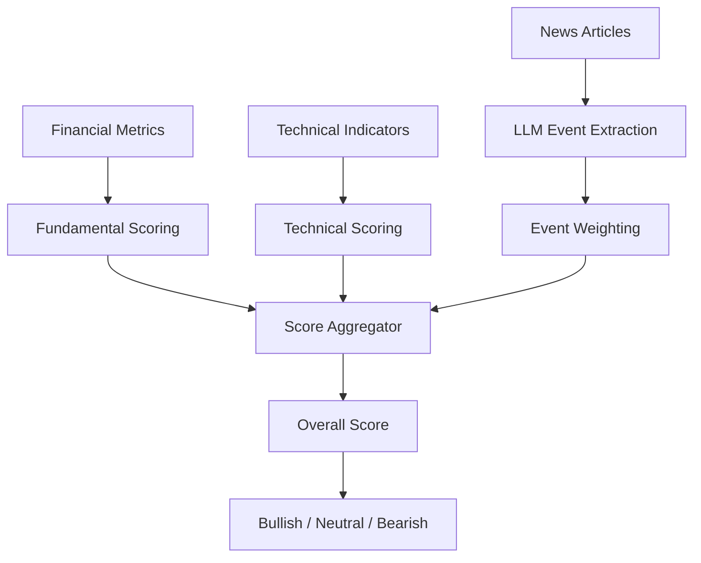
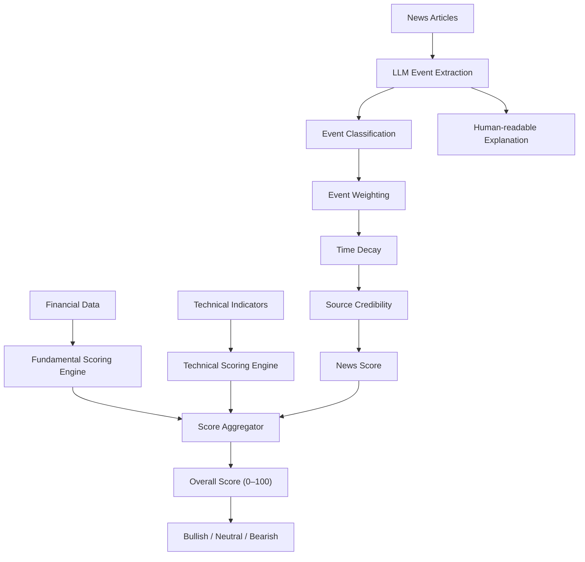

# Stock Analysis Methodology (Objective & Explainable)

## Overview

The current methodology relies on a Large Language Model (LLM) to directly determine whether a stock is **Bullish**, **Bearish**, or **Neutral**. While this produces human-like analyses, it suffers from several issues:

- LLMs have an optimism bias.
- They lack calibration for financial predictions.
- Results are difficult to reproduce.
- Small prompt changes can significantly alter outcomes.
- The reasoning behind the final sentiment is often opaque.

Instead of allowing the LLM to make the final investment decision, it should be used as an **information extraction engine**, while deterministic algorithms perform the scoring.

---

# Problems with the Current Approach

## 1. No Baseline for Comparison

Current inputs:

- Market Cap
- P/E Ratio
- 52-week High
- 52-week Low
- News Articles

These values have no context.

Example:

A P/E ratio of **40** may be:

- Extremely expensive for a bank
- Normal for a SaaS company
- Cheap for a fast-growing AI company

Without sector-relative comparisons, the LLM is forced to guess.

---

## 2. Insufficient Financial Metrics

Current financial inputs provide very limited insight.

### Recommended Metrics

| Category | Metrics |
|-----------|----------|
| Valuation | P/E, Forward P/E, PEG Ratio, EV/EBITDA, Price/Book |
| Growth | Revenue Growth, EPS Growth |
| Profitability | ROE, ROA, Operating Margin, Net Margin |
| Liquidity | Current Ratio, Quick Ratio |
| Leverage | Debt-to-Equity Ratio |
| Cash Flow | Free Cash Flow, Operating Cash Flow |
| Momentum | 50 DMA, 200 DMA |
| Volatility | Beta, ATR |

---

## 3. All News is Treated Equally

Ten positive articles do not outweigh one major negative event.

Example:

- 8 articles about CSR initiatives
- 1 article about a product launch
- 1 article about an SEC fraud investigation

A naïve sentiment approach may classify this as positive.

A professional investor would consider it highly bearish.

News importance matters more than news count.

---

## 4. No Confidence Estimation

The system always returns a prediction.

Even if:

- only two articles exist
- articles are old
- articles are duplicates

the model still outputs Bullish/Bearish.

Instead, every prediction should include a confidence score.

---

## 5. LLM is Making the Final Decision

Current prompt:

> Cross-reference financial data with news and determine whether the stock is bullish or bearish.

This encourages the LLM to become a market analyst.

Instead, the LLM should only extract structured information.

---

# Recommended Architecture



---

# Proposed Scoring System

## Overall Score

```
Overall Score =
0.40 × Fundamental Score
+
0.30 × Technical Score
+
0.30 × News Score
```

Scores are normalized to **0–100**.

Classification:

| Score | Classification |
|---------|----------------|
| 70–100 | Bullish |
| 40–69 | Neutral |
| 0–39 | Bearish |

---

# 1. Fundamental Score (40%)

This score should be entirely deterministic.

No LLM should be involved.

Possible factors:

- Forward P/E
- PEG Ratio
- Revenue Growth
- EPS Growth
- ROE
- ROA
- Operating Margin
- Net Margin
- Debt-to-Equity
- Free Cash Flow
- Current Ratio

Each metric should be normalized within its sector.

Output:

```
Fundamental Score = 0–100
```

---

# 2. Technical Score (30%)

Again, entirely deterministic.

Possible indicators:

- RSI
- MACD
- Moving Average Crossovers
- ADX
- Volume Trends
- VWAP
- Bollinger Bands
- 52-week Breakout
- Momentum Indicators

Output:

```
Technical Score = 0–100
```

---

# 3. News Score (30%)

This is where the LLM should be used.

Instead of asking:

> Is this bullish?

Ask the LLM to analyze each article independently.

For every article:

```json
{
  "event": "",
  "category": "",
  "impact": -3,
  "importance": 0.0,
  "confidence": 0.0,
  "reason": ""
}
```

Where:

Impact:

- -3 = Extremely Negative
- -2 = Negative
- -1 = Slightly Negative
- 0 = Neutral
- +1 = Slightly Positive
- +2 = Positive
- +3 = Extremely Positive

Importance:

```
0 → 1
```

Confidence:

```
0 → 1
```

---

## News Score Formula

```
News Score =
Σ(
Impact
× Importance
× Confidence
× TimeDecay
× SourceWeight
)
```

---

# Event Taxonomy

Force the LLM to classify every article.

Allowed categories:

- Earnings Beat
- Earnings Miss
- Guidance Increase
- Guidance Cut
- Dividend Increase
- Dividend Cut
- Acquisition
- Merger
- Product Launch
- Partnership
- CEO Appointment
- CEO Resignation
- Fraud Investigation
- Lawsuit
- Bankruptcy
- Credit Downgrade
- Analyst Upgrade
- Analyst Downgrade
- Interest Rate Decision
- Inflation
- Government Policy
- Regulation
- Sector News
- Geopolitical Event

This makes the LLM deterministic instead of free-form.

---

# Default Event Weights

Example weighting:

| Event | Weight |
|---------|---------|
| Earnings Beat | +3 |
| Earnings Miss | -3 |
| Guidance Raised | +3 |
| Guidance Cut | -3 |
| Fraud Investigation | -3 |
| Bankruptcy | -3 |
| Acquisition | +2 |
| Dividend Increase | +1 |
| Product Launch | +1 |
| CEO Resignation | -2 |
| Lawsuit | -2 |
| Analyst Upgrade | +1 |
| Analyst Downgrade | -1 |

These weights can later be tuned.

---

# Time Decay

Recent news should matter more.

Example:

| Age | Weight |
|------|---------|
| Today | 1.0 |
| 1–3 Days | 0.9 |
| 4–7 Days | 0.7 |
| 8–14 Days | 0.5 |
| 15–30 Days | 0.3 |
| Older than 30 Days | 0.1 |

---

# Source Credibility

Different publishers should carry different trust levels.

Example:

| Source | Weight |
|----------|---------|
| Bloomberg | 1.00 |
| Reuters | 1.00 |
| Wall Street Journal | 0.95 |
| Financial Times | 0.95 |
| CNBC | 0.90 |
| Yahoo Finance | 0.85 |
| MarketWatch | 0.80 |
| Seeking Alpha | 0.75 |
| Company Press Release | 0.70 |
| Unknown Blog | 0.30 |

---

# Duplicate News Detection

Many articles describe the same event.

Example:

- Reuters reports earnings.
- Yahoo republishes Reuters.
- CNBC summarizes Reuters.

This should count as **one event**, not three.

Recommended approach:

- Generate embeddings for each article.
- Cluster similar articles.
- Score only one representative event.

---

# Confidence Estimation

Every prediction should include confidence.

Confidence depends on:

- Number of independent news events
- Agreement between sources
- Freshness
- Availability of financial metrics
- Technical indicator agreement

Example:

```
Bullish

Confidence: 87%
```

instead of simply:

```
Bullish
```

---

# Explainable AI

Every score should be explainable.

Example output:

```json
{
  "fundamental_score": 74,
  "technical_score": 61,
  "news_score": 82,
  "overall_score": 72,
  "classification": "Bullish",
  "confidence": 0.87
}
```

Supporting explanation:

```json
[
  {
    "event": "Quarterly Earnings Beat",
    "impact": 3,
    "importance": 0.95,
    "confidence": 0.94,
    "reason": "EPS exceeded analyst expectations by 18%."
  },
  {
    "event": "New Product Launch",
    "impact": 1,
    "importance": 0.40,
    "confidence": 0.81,
    "reason": "Potential future revenue catalyst."
  }
]
```

This makes every recommendation auditable.

---

# Role of the LLM

The LLM should **not** decide:

- Bullish
- Bearish
- Neutral

Instead, it should perform:

- Event extraction
- Event classification
- Impact estimation
- Explanation generation
- Duplicate identification
- Risk identification
- Catalyst identification

The deterministic scoring engine should produce the final classification.

---

# Final Pipeline



---

# Guiding Principle

The system should treat the LLM as an **expert financial analyst that extracts structured evidence**, **not** as the decision-maker.

The final sentiment should be computed by transparent, deterministic algorithms using weighted fundamentals, technical indicators, and structured news events. This approach produces consistent, explainable, reproducible, and tunable results while still leveraging the LLM's strength in understanding complex financial narratives.